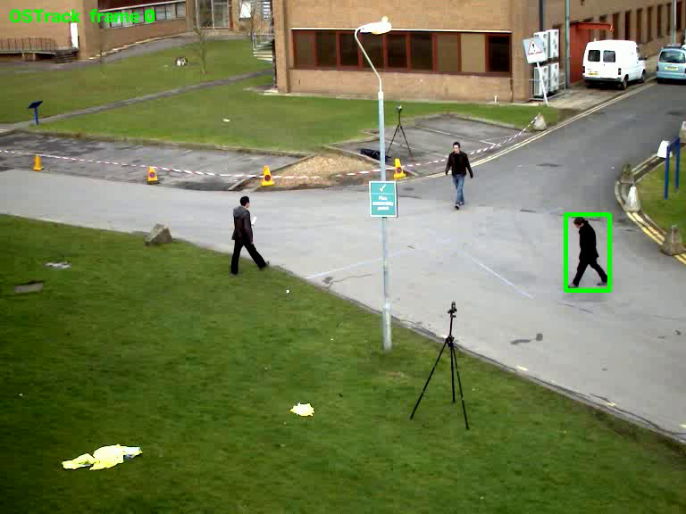
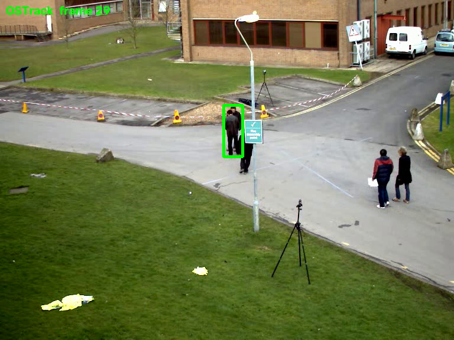

# OSTrack 推理环境配置与运行记录

本仓库记录在 RTX 3050 Laptop（4 GB 显存）上以 CPU 运行 OSTrack 推理的完整过程：环境配置、与官方脚本的差异、运行结果与限制。

OSTrack 是 ECCV 2022 提出的单目标跟踪方法，将模板与搜索区拼接为一个序列送入 ViT，用自注意力同时完成特征提取与关系建模，并使用候选早消除（ECE）模块降低推理计算量。

## 1. 环境

| 项 | 值 |
|---|---|
| 操作系统 | Windows（PowerShell 7） |
| Python | 3.8.6（独立 venv） |
| PyTorch | 1.13.1+cpu |
| torchvision | 0.14.1+cpu |
| timm | 0.5.4 |
| OpenCV | opencv-python-headless 5.0.0 |
| NumPy | 1.24.4 |
| GPU | NVIDIA RTX 3050 Laptop，4096 MiB，驱动 610.62（本次未使用） |
| 推理设备 | CPU |

## 2. 模型与权重

| 项 | 值 |
|---|---|
| 代码 | [botaoye/OSTrack](https://github.com/botaoye/OSTrack)，commit `33b5e12` |
| 配置 | `experiments/ostrack/vitb_384_mae_ce_32x4_ep300.yaml` |
| 输入尺寸 | template 192×192，search 384×384 |
| 权重来源 | [ModelScope](https://www.modelscope.cn/models/damo/cv_vitb_video-single-object-tracking_ostrack) `pytorch_model.bin` |
| 权重大小 | 371,408,049 字节，文件内含 `net` 字段的完整 checkpoint |
| 存放位置 | `output/checkpoints/train/ostrack/<config>/OSTrack_ep0300.pth.tar` |

权重版本必须与配置对应：384 版本的 `backbone.pos_embed_z` / `pos_embed_x` 分别为 144 / 576 个 token，256 版本为 64 / 256，两者不能互换。

## 3. 实现方式

官方 `tracking/video_demo.py` 依赖 cv2 窗口交互，且在 `lib/test/tracker/ostrack.py` 中直接调用 `.cuda()`，无法在无窗口、无 GPU 的环境运行。本仓库做了以下调整：

1. **无窗口运行**：`run_demo_cpu.py` 从命令行接收初始框，逐帧读取视频、推理、绘制预测框并写出 mp4，不调用任何 cv2 窗口函数。
2. **CPU 运行**：在导入跟踪器前将 `Tensor.cuda` 与 `Module.cuda` 替换为空操作，模型与输入保持在 CPU 上。
3. **依赖占位**：`jpeg4py` 与 `visdom` 在 `lib` 的 import 阶段被引用，但不参与推理流程；`stubs/` 下提供占位模块，避免安装不可用的依赖。
4. **配置文件生成**：官方 `create_default_local_file.py` 将路径写入单引号字符串，Windows 路径中的 `\u`、`\t` 会被解析为转义符；`scripts/make_local_config.py` 改用 raw string 生成 `lib/test/evaluation/local.py`。
5. **权重获取**：官方权重位于 Google Drive；`scripts/download_weights.py` 从 ModelScope 下载并放置到配置对应的目录。

## 4. 运行结果

测试视频为 OpenCV 样例 `samples/data/vtest.avi`（768×576，10 fps，795 帧），初始框 `[638, 236, 50, 86]`。

| 运行 | 帧数 | 耗时 | 平均 FPS | 初始化 | 首帧框 | 末帧框 |
|---|---|---|---|---|---|---|
| 30 帧 | 30 | 22.6 s | 1.33 | 8 ms | `[633, 240, 49, 85]` | `[378, 178, 32, 87]` |
| 60 帧 | 60 | 38.3 s | 1.57 | 16 ms | `[633, 240, 49, 85]` | `[365, 168, 22, 69]` |

原始数据见 `results/metrics.json` 与 `results/metrics_60f.json`。

30 帧运行的逐帧结果：


首帧与末帧（30 帧运行）：

<p>


</p>

60 帧运行的末帧框为 22×69（首帧 49×85），位置已偏离目标主体。本次未对该段做误差量化，也未分析原因。

## 5. 限制

- 未使用 ground truth，未计算 PR / SR，未做任何 benchmark 评测。
- CPU 推理速度与模型性能无关，不能与论文中 RTX2080Ti 的数字比较。
- 仅验证推理链路；训练与评测需在 GPU 服务器上进行。
- 单次运行、单段视频，结果不具备统计意义。

## 6. 复现

```powershell
git clone https://github.com/botaoye/OSTrack.git ..\OSTrack
cd ostrack-demo

powershell -ExecutionPolicy Bypass -File scripts\setup.ps1
.\.venv\Scripts\python.exe scripts\make_local_config.py --ostrack ..\OSTrack
.\.venv\Scripts\python.exe scripts\download_weights.py --ostrack ..\OSTrack
.\.venv\Scripts\python.exe scripts\get_sample_video.py --out data\vtest.avi

.\.venv\Scripts\python.exe run_demo_cpu.py `
    --ostrack ..\OSTrack --video data\vtest.avi --box 638 236 50 86 `
    --out results\demo_30f.mp4 --max-frames 30 --metrics results\metrics.json
```

环境问题与处理方式见 [docs/pitfalls.md](docs/pitfalls.md)。

## 7. 引用与许可

- 论文：Ye et al., *Joint Feature Learning and Relation Modeling for Tracking: A One-Stream Framework*, ECCV 2022. [arXiv:2203.11991](https://arxiv.org/abs/2203.11991)
- 代码：[botaoye/OSTrack](https://github.com/botaoye/OSTrack)，MIT License，Copyright (c) 2022 Botao Ye
- 权重：ModelScope `damo/cv_vitb_video-single-object-tracking_ostrack`
- 测试视频：OpenCV `samples/data/vtest.avi`

本仓库脚本采用 MIT License，见 [LICENSE](LICENSE)；不包含 OSTrack 源码与模型权重。
